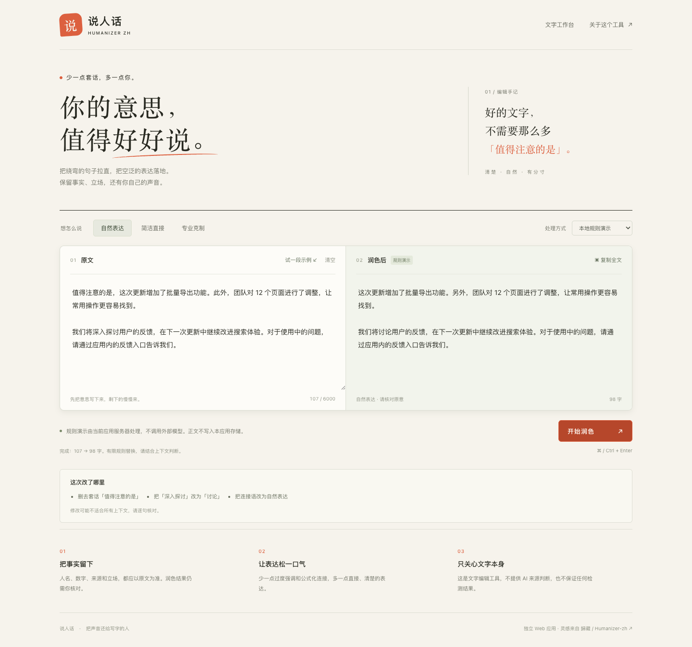

# 说人话 · Humanizer-zh Web

一个小而克制的中文文字编辑器。删去冗长套话，比较润色前后，让作者自己决定怎么说。

本仓库是**独立 Web 应用**，非归藏的同名技能官方版本。编辑方向受到 [歸藏 / op7418 的 Humanizer-zh](https://github.com/op7418/Humanizer-zh) 启发；来源和上游 MIT 许可见 [THIRD_PARTY_NOTICES.md](THIRD_PARTY_NOTICES.md)。



## 能做什么

- **无需 API 密钥的规则演示**：对少量预设套话做保守替换，并列出改动。不会理解全文，也不是完整模型润色。
- **可选模型润色**：服务端配置支持 Responses API 的服务和模型后，用户明确同意发送原文才调用；密钥不出现在网页中。
- 自然表达、简洁直接、专业克制三种语气；原文 / 结果双栏、字数、示例、复制、清空、快捷键。
- 单页原生 HTML / CSS / JavaScript，无前端构建步骤，支持手机屏幕和键盘操作。

这是一项写作辅助工具，不判断文字由谁生成，不提供或保证任何 AI 检测结果。规则和模型都可能不适合特定上下文，使用前请核对原意、事实、专名和数字。

## 本地启动

需要 Python 3.9+，建议使用 Python 3.12。

```bash
git clone https://github.com/xlmsyq/humanizer-zh.git
cd humanizer-zh
python3 -m venv .venv
source .venv/bin/activate
# Windows PowerShell: .venv\Scripts\Activate.ps1
python -m pip install -r requirements.txt
python -m uvicorn app.main:app --host 127.0.0.1 --port 8000
```

在浏览器打开 <http://127.0.0.1:8000>。不配置环境变量即可体验**本地规则演示**。点击「试一段示例」，选择语气，再点「开始润色」或按 `⌘ / Ctrl + Enter`。

## 可选：启用模型

模型适配器使用 [OpenAI Responses API 格式](https://developers.openai.com/api/docs/guides/text)：向 `{HUMANIZER_API_BASE}/responses` 发送 `model`、`instructions`、`input`、`max_output_tokens`、`store: false`，聚合返回 `output[]` 中 assistant message 的 `output_text`。只接受 `status: completed` 的完整文本；并非所有标称兼容 Chat Completions 的服务都支持它。

在**启动服务的环境**中配置以下变量，再重启应用：

| 变量 | 含义 |
| --- | --- |
| `HUMANIZER_API_BASE` | HTTPS API 基址，默认 `https://api.openai.com/v1`；不要填写 `/responses` 后缀。 |
| `HUMANIZER_API_KEY` | 你的服务端 API 密钥。默认空，模型模式关闭。 |
| `HUMANIZER_MODEL` | 你账号可用、支持 Responses API 的模型 ID。默认空。 |

复制 `.env.example` 可作为配置参考。应用不会自动加载 `.env`；可用系统环境变量启动，或另行安装 `python-dotenv` 后使用 `uvicorn --env-file .env`。不要提交 `.env` 或把密钥写进前端代码。

配置成功后，页面「处理方式」中会启用「模型润色」并显示发送目标域名。模型服务可能计费，原文发送前必须勾选同意。

**发布源码与托管应用不同。** GitHub Pages 不能运行本项目的 Python 服务。若要对外托管，需要 Python ASGI 运行环境；本版本没有用户登录和请求额度控制，带有模型密钥的实例应放在仅自己可用或有身份认证、限流的访问入口后。

## 文本和隐私

- 规则演示也会将正文提交给当前运行的应用服务器；本机启动时处理在本机服务器完成，不调用外部模型。
- 本应用不将正文写入文件、数据库、浏览器 `localStorage` 或分析服务。页面刷新会丢失当前内容。输入和结果处理期间会存在内存中。
- 模型模式会把原文及编辑要求发送到服务端配置的模型服务。请求设为 `store: false`，但这不等于服务商不留日志或零数据保留；以所用服务商政策为准。
- 模型失败不会自动改用另一家服务，也不会自动把内容发送出去。原文保留在左侧。
- 内置示例为虚构的产品更新文字，不含真实个人、招聘岗位或客户数据。

## 测试

```bash
python -m pip install -r requirements-dev.txt
python -m pytest -q
```

当前包含 **20 项自动测试**（参数化用例计入），覆盖规则、语气差异、姓名和数值保留、输入与请求大小校验、模型发送同意、未配置状态、密钥不暴露、Responses 解析、畸形或不完整响应、服务商错误和超时。模型测试使用 mock，不调用真实收费接口。

GitHub Actions 在 Python 3.10 / 3.12 下执行测试。实际验证记录和截图说明见 [docs/VERIFICATION.md](docs/VERIFICATION.md)。

## API

`GET /api/health` 返回 `{"status":"ok"}`；`GET /api/config` 只返回模型是否已配置、服务域名和输入上限，不返回密钥或模型 ID。

`POST /api/rewrite` 接收 JSON，请求头必须含 `Content-Type: application/json` 和 `X-Humanizer-Request: 1`：

```json
{
  "text": "值得注意的是，这次更新增加了批量导出功能。",
  "tone": "natural",
  "engine": "demo",
  "consent": false
}
```

`tone` 可选 `natural` / `concise` / `professional`，`engine` 可选 `demo` / `model`。`model` 必须同时有服务端配置和 `consent: true`。原文最多 6000 个字符；JSON 请求体最多 64 KiB。

## 目录

```text
app/main.py            FastAPI 接口与服务端模型适配
app/rewriter.py        规则演示与编辑提示
app/static/            单页前端（无构建步骤）
tests/                 自动测试
docs/screenshots/      本地运行页面的真实截图
third_party/           上游许可声明
```

项目代码使用 [MIT License](LICENSE)。欢迎通过 Issue 或 Pull Request 提供更准确的规则、无隐私风险的例句与修复。
